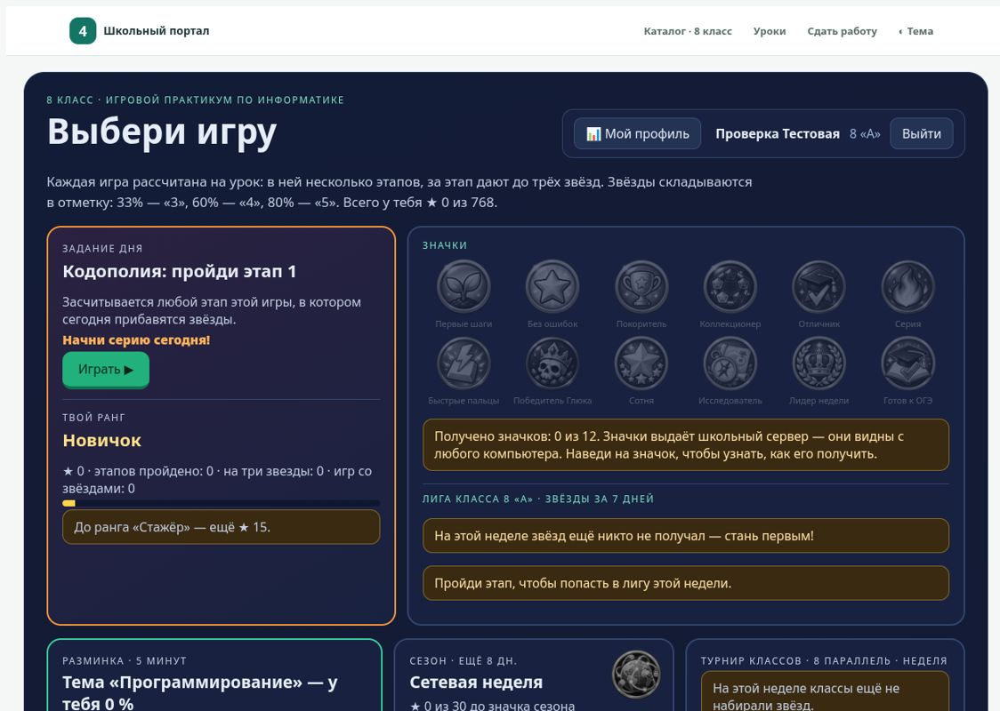
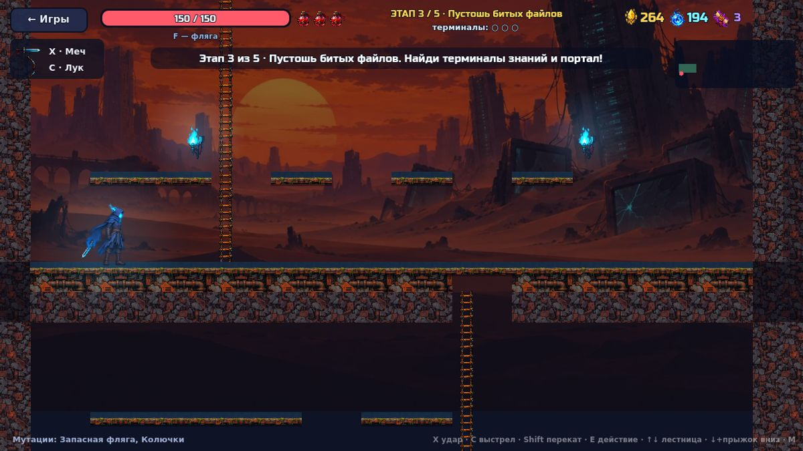
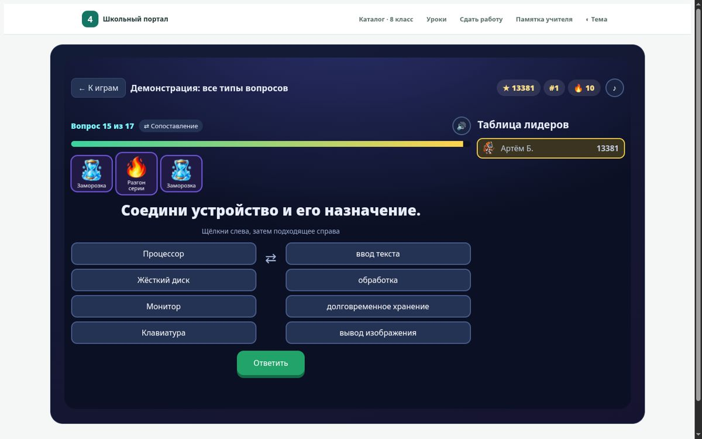
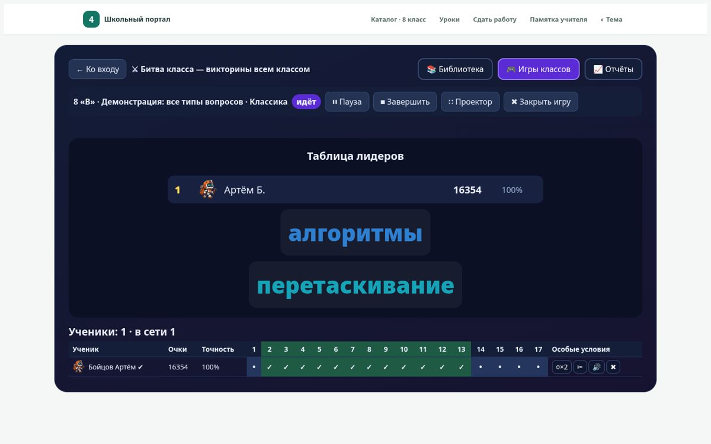
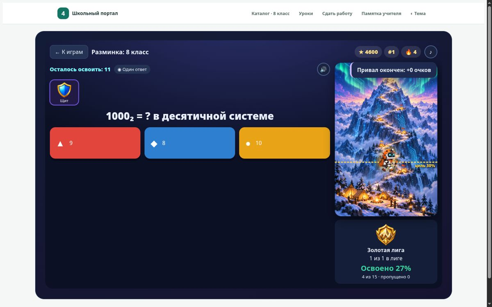
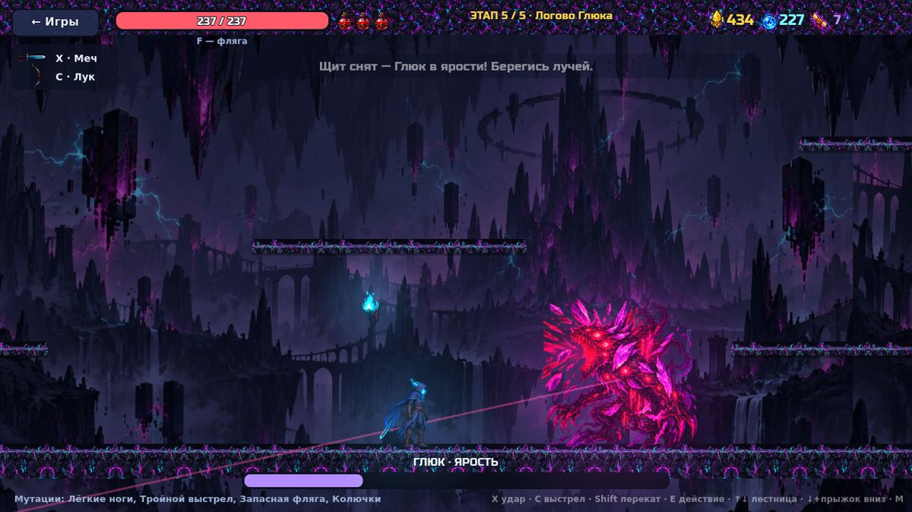
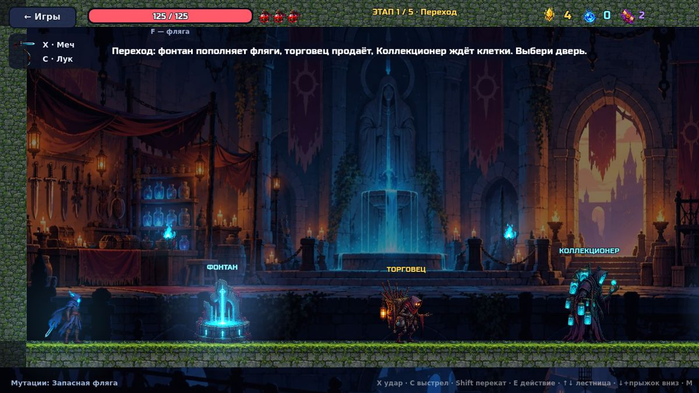
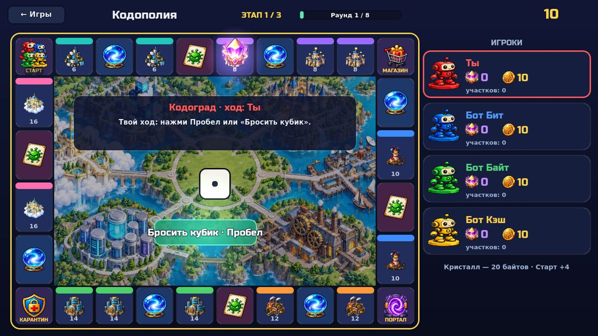
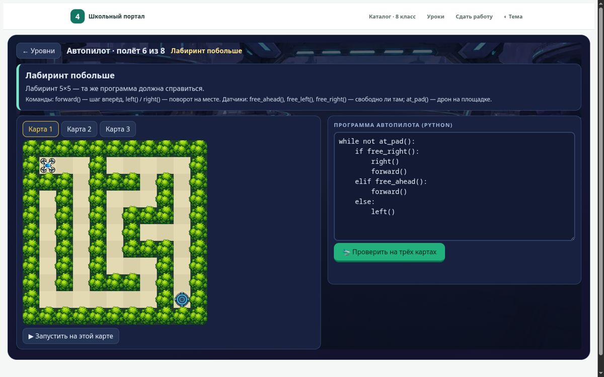
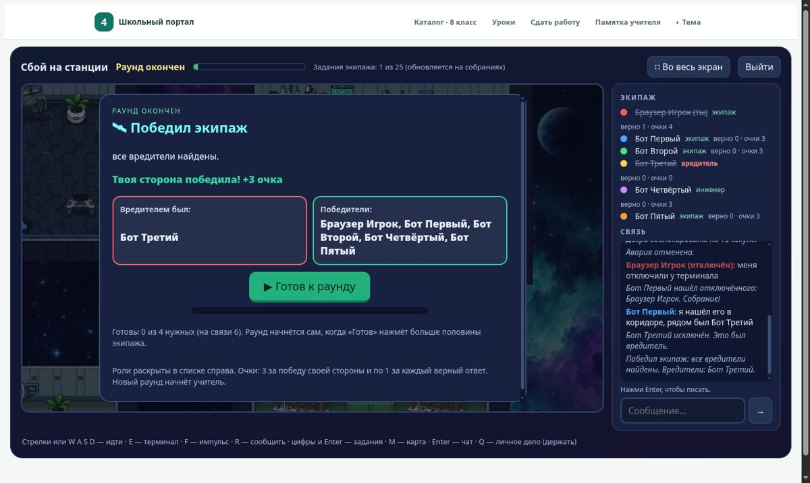

# Игровой практикум по информатике (6–11 классы)

Учебные игры, тренажёры и сетевые игры для всего класса, которые я сделал для школьного портала на уроках информатики.
Всё работает в локальной сети школы: ученики открывают игры в браузере, прогресс и звёзды хранит школьный сервер,
учитель видит статистику класса. Темы — по УМК Л. Л. Босовой и задания ОГЭ/ЕГЭ.

Проект собран с помощью Claude Code: код, тесты и сборка — в этом репозитории; иллюстрации и спрайты сгенерированы
через Codex (промпты лежат рядом с исходными листами в `tools/art*/raw/gen.sh` и `godot/workshop/cells/art_raw/prompts.tsv`).

## Что внутри

| Раздел | Где | Что это |
|---|---|---|
| Игровой практикум | `tools/practicum/` | Единая страница игр класса: вход по классу и имени, звёзды и отметка, задание дня, значки, лиги, сезоны, разминка по слабым темам, профиль ученика, панель учителя с тепловой картой |
| «Битва класса» | `tools/practicum/battle*.js`, `tools/battle/server/` | Свой аналог Wayground (Quizizz): 17 типов вопросов, режимы «классика», «под руководством учителя», «командный», «тест» и «Восхождение» (гора, лиги, привалы с мини-играми), усилители, мемы, редактор викторин, живая таблица учителя, проектор, отчёты с CSV. Ученики попадают в лобби автоматически, без кодов |
| Лаборатория | `tools/lab/` | 20 браузерных игр по темам учебника: ОГЭ- и ЕГЭ-арены, пробный ОГЭ, «Автопилот» (Python с датчиками), «Собери компьютер», «Верстальщик», логика, сети, базы данных, исполнители и др. Свой интерпретатор Python — `tools/codehero/core.js` |
| Мастерская роботов (Godot 4) | `godot/workshop/` | Программирование робота блоками и 8 аркад: «Клетки памяти» (экшен в духе Dead Cells — большие ветвистые уровни, лестницы и лифты, 11 видов врагов, три босса, торговцы и Коллекционер клеток), «Кодополия» (настольная игра, в том числе по сети на четверых с лобби), «Двоичный десант», «2048» и другие |
| «Сбой на станции» | `tools/crew/` | Сетевая игра в духе Among Us для класса: задания — вопросы по информатике, собрания и тайное голосование, старт раунда голосованием игроков, пульт учителя |
| Тренажёры | `tools/trainer/`, `tools/typing_escape/` | «Кодоград», «Битва с Глюком», клавиатурный тренажёр «Тенегрыз» с рекордами класса |
| Серверные модули | `tools/*/server/*.py` | Небольшие модули Flask, которые подключаются к школьному журналу: прогресс, статистика, комнаты сетевых игр. Каждый модуль проверяется своим тестом |
| Публикация | `tools/publish.py` | Проверка и сборка задания из JSON, публикация в каталог портала с резервной копией |
| Видео | `tools/video/` | Музыка и сцены для промо-ролика практикума (рендер через браузер и ffmpeg) |

## Скриншоты

| | |
|---|---|
|  |  |
|  |  |
|  |  |
|  |  |
|  |  |

## Технологии

- **Фронтенд:** чистый JavaScript и CSS без сборщиков и внешних CDN (сайт работает в закрытой школьной сети).
- **Игры на Godot 4.7** (GDScript), экспорт в веб; загрузчик дорабатывается для работы по http в локальной сети.
- **Сервер:** Python, Flask, SQLite — модули подключаются к существующему школьному журналу.
- **Тесты:** логика игр без браузера (Node), серверные модули (Flask test client), Godot headless (генератор уровней «Клеток памяти» — 200 случайных уровней на проходимость) и браузерные сценарии через Chrome DevTools Protocol — от входа ученика до полного забега с боссами.

Запуск всех проверок: `bash tools/run_all_tests.sh` (только логика без браузера: `bash tools/run_all_tests.sh quick`).

## Чего здесь нет

Настоящих учеников, оценок и журнала, паролей и настроек школьной сети; готовых заданий с ответами (папка `drafts/`), собранных страниц,
резервных копий и видео. Адрес школьного сервера заменён на `portal.school.local`. Шрифты для промо-ролика (Unbounded и Manrope,
Google Fonts, лицензия OFL) нужно положить в `tools/video/fonts/` самостоятельно.
